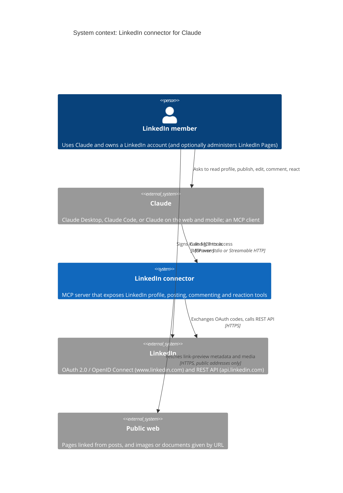
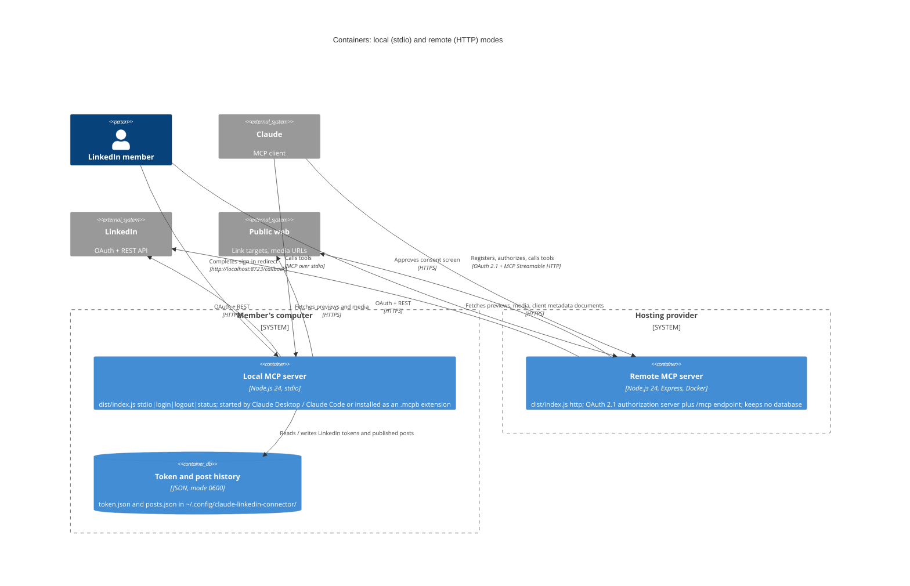
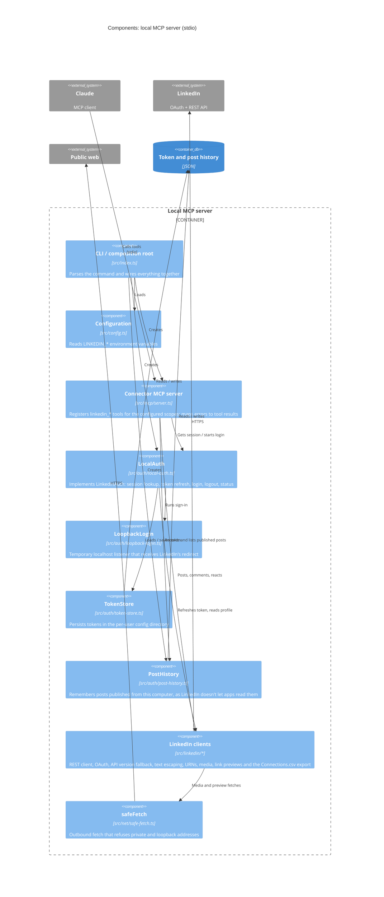
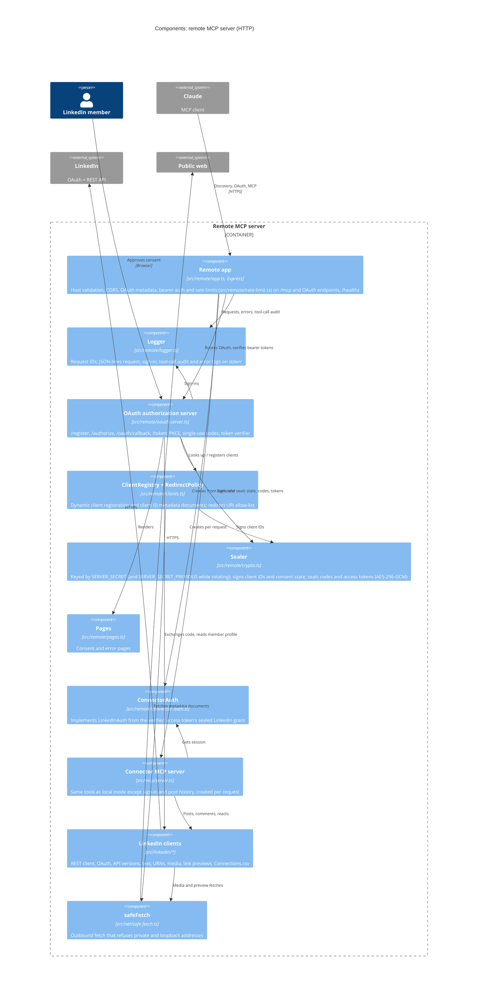

# Architecture

C4 diagrams of the connector, from the outside in, in [Mermaid's C4 syntax](https://mermaid.js.org/syntax/c4.html)
(GitHub renders them inline), then the module layering, which
[`test/architecture.test.ts`](../test/architecture.test.ts) enforces.

## Level 1: System context

## Level 2: Containers

The same code base ships as two deployables. Local mode is a process Claude starts on the member's computer;
remote mode is a stateless HTTP server that Claude reaches as a custom connector.

In remote mode the LinkedIn token never touches disk: it is sealed with `SERVER_SECRET` (AES-256-GCM) inside
the access token the server issues to Claude, so any instance holding the same secret can serve any request.
[`deployment.md`](deployment.md) covers running it in production.

## Level 3: Components of the local MCP server

## Level 3: Components of the remote MCP server

## Module layering

The code in `src/`, bottom to top; each layer may import only from layers below it.

| Layer | Modules | Notes |
|---|---|---|
| Leaf | `errors.ts`, `version.ts`, `html.ts`, `paths.ts`, `json.ts` | No project imports |
| Network | `net/` | `safeFetch` refuses private and loopback addresses; no LinkedIn or MCP knowledge |
| LinkedIn | `linkedin/` | REST client, OAuth, text escaping, media, link previews, API versions, `Connections.csv`; `client.ts` and `oauth.ts` are the only code allowed to call the global `fetch`, since the other modules fetch URLs the user gave through `safeFetch` |
| Local auth, config | `auth/`, `config.ts` | Token storage, post history and browser sign-in; environment variables |
| MCP | `mcp/` | Tools (`server.ts`); transport agnostic, so of `auth/` it loads only the hints (`hints.ts`) and the interfaces (`types.ts`), never the sign-in or token storage, even indirectly |
| Remote | `remote/` | HTTP app, OAuth authorization server, client registration, logging, rate limits; the only code allowed to use Express; never reaches local sign-in or token storage, even through `mcp/` |
| Composition root | `index.ts` | CLI (`stdio`, `http`, `login`, `logout`, `status`); imported by nothing |
