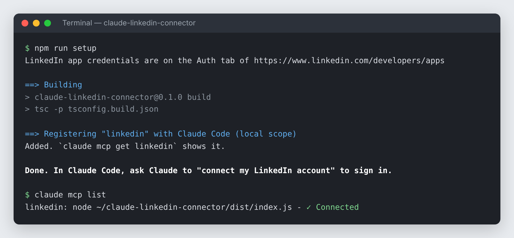
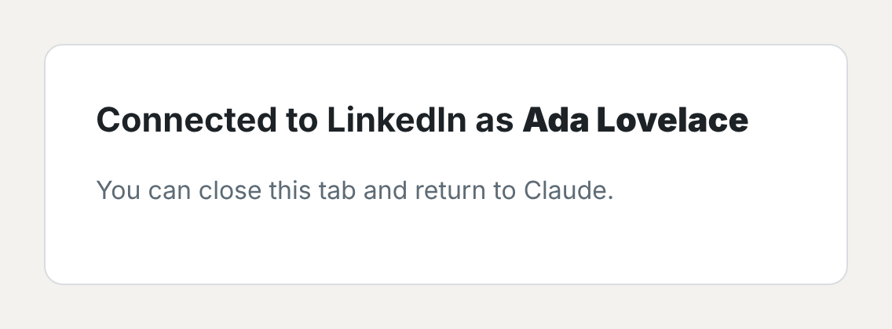
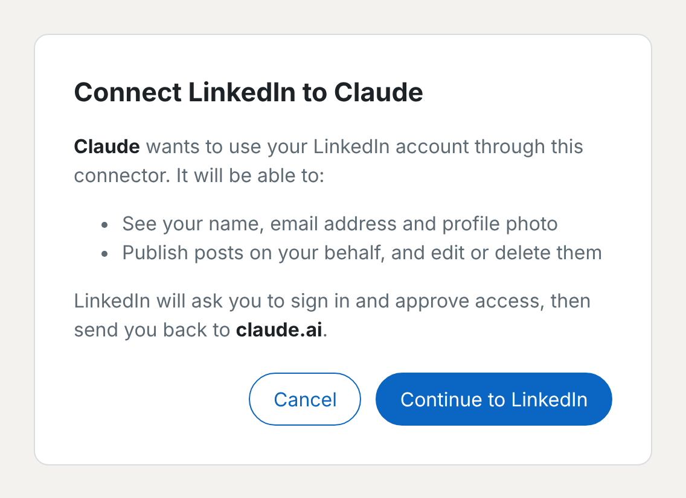
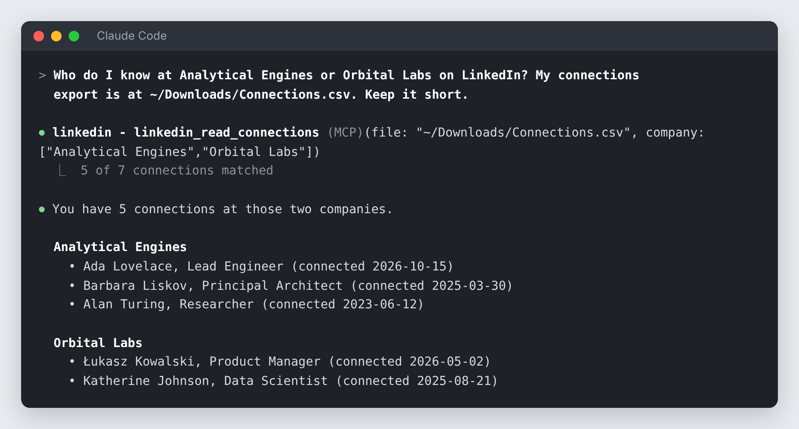

# Using the LinkedIn connector

A walkthrough from installing the connector to everyday requests. It assumes you've created a LinkedIn app
as described in the [quick start](../README.md#quick-start); the screenshots use Claude Code, but the
requests work the same in Claude Desktop and Claude on the web.

## 1. Install it

From a clone of this repository, run `npm run setup`. It asks for your app's Client ID and Client Secret,
builds the connector and registers it with Claude Code. `claude mcp list` then shows it as connected:

In Claude Desktop, install the `.mcpb` extension from the
[latest release](https://github.com/adamw7/claude-linkedin-connector/releases/latest) instead. For Claude on
the web or mobile, see [Remote server](../README.md#remote-server).

## 2. Sign in to LinkedIn

Ask Claude:

> Connect my LinkedIn account

LinkedIn's sign-in page opens in your browser (if it doesn't, Claude gives you the link). Approve access, and the
browser lands on this page:

Claude notices by itself and carries on; there's no need to tell it you're done. Asking for something that needs
LinkedIn before signing in starts the same sign-in. "Am I connected to LinkedIn?" shows who you're signed in as and when the sign-in
expires (after 60 days). LinkedIn signs in whoever is signed in to linkedin.com in your browser, so to switch
accounts, sign out of linkedin.com first, then ask Claude to sign you in to LinkedIn again.

With a remote server, the connector instead shows its own consent screen when you click **Connect** in
Claude's connector settings, listing what Claude will be able to do, before sending you to LinkedIn:

## 3. Ask Claude

Talk to Claude normally; it picks the right tool. For example, with LinkedIn's data export (**Settings → Data
privacy → Get a copy of your data → Connections**) saved in your Downloads folder, no need to unzip it:

*Drawn from a real Claude Code session with the connector, using a sample `Connections.csv` with made-up
people.*

More things to try:

| Ask | Tool used |
|---|---|
| "What's my LinkedIn profile?" | `linkedin_get_profile` |
| "How many of my connections work at each company? Top 10." | `linkedin_read_connections` |
| "Who did I connect with this year?" | `linkedin_read_connections` |
| "Draft a LinkedIn post announcing our 2.0 release, then publish it once I approve." | `linkedin_create_post` |
| "Share https://example.com/blog/launch on LinkedIn with a two-line intro." | `linkedin_create_post` (link preview) |
| "Post these three photos with the caption …" | `linkedin_create_post` (images) |
| "Publish slides.pdf as a LinkedIn carousel titled 'Q3 results'." | `linkedin_create_post` (document) |
| "Fix the typo in the post you just published." | `linkedin_edit_post` |
| "Delete that post." | `linkedin_delete_post` |
| "What have I posted on LinkedIn this month?" (local mode) | `linkedin_list_posts` |
| "In my post about the 2.0 release, change 'Tuesday' to 'Wednesday'." (local mode, any conversation) | `linkedin_list_posts`, then `linkedin_edit_post` |
| "Comment 'Congratulations!' on <post URL>" / "Like <post URL>" | `linkedin_comment_on_post` / `linkedin_react_to_post` (need extra LinkedIn access) |
| "Sign me out of LinkedIn." | `linkedin_logout` |

## What to expect when posting

- **You approve every post.** Claude shows you the exact text, and any image, link or document, and waits
  for your OK before publishing, editing, commenting or deleting. Claude also asks you to allow each tool
  call unless you've allowed it permanently.
- **Claude checks the post first.** Before asking for your OK, Claude previews the post without publishing it:
  it loads the images or document, so a wrong path or format shows up now rather than after you've approved,
  and tells you what the link preview card will show. If the page has no usable title or image, you can give
  your own (for example "use cover.png from my Downloads as the preview image"). A link in the text alone gets no
  card, so Claude tells you when a post has one without a link preview.
- **Write plain text.** LinkedIn doesn't render Markdown. Line breaks, emoji and `#hashtags` work, and the
  connector escapes characters such as `( ) * _` so LinkedIn doesn't cut the post short. `@mentions` show as
  plain text and don't tag anyone. A post can have up to 3,000 characters and a comment 1,250; for a longer draft,
  the connector tells Claude how much to cut.
- **Claude gets the post's URL back**, so you can say "edit that post" or "delete it" right afterwards.
- **One kind of attachment per post**: a link preview, 1–20 images, or one document.
- **Posting as a Page** (if turned on) works for Pages you're a super admin or content admin of. Name the Page by
  the address of its admin view, `linkedin.com/company/<ID>/admin/`: its public address usually has a name
  instead of the number LinkedIn needs. A Page's posts are always public.
- **Claude can't read your feed or past posts.** LinkedIn only gives that to partner apps. In local mode
  (Claude Desktop, Claude Code) the connector remembers the last 100 posts it published, with their text, so
  you can edit or delete them from any conversation later. For other posts, or in remote mode, keep the URL
  Claude gives you after publishing: a link copied from linkedin.com often won't work, but the code from the
  post's **Embed this post** menu item will.
- **Give files by name or link, not as attachments.** Claude can't pass on an image or document you attach in the
  chat: it sees what's in it, not the file. In local mode, save the file and tell Claude its name: the connector
  finds it, and asks for the full path if two folders have a file by that name. With a remote server, give a link
  to the file itself. Local files are only read from your Downloads, Desktop and Pictures folders (also the ones
  OneDrive keeps on Windows) and the folder the connector runs in, so a page or document Claude reads can't get it
  to post other files from your computer. To use other folders, set **Folders for local files** in the Claude
  Desktop extension's settings, or run `npm run setup -- --yes --file-dirs <folders>` again for Claude Code
  (`LINKEDIN_FILE_DIRS`). It replaces the default folders, so list the ones you want
  to keep too; if a file is outside them, the error message gives the value to use. It never suggests your home
  folder itself, which would open up all your files: move the file instead.
- **Images must be JPEG, PNG or GIF, and documents PDF or Office files.** Convert iPhone photos (HEIC) and WebP
  images to JPEG or PNG, and export Keynote or Pages files as PDF; the connector tells you what it got. Video
  posts aren't supported.

## Your connections

LinkedIn's API doesn't give apps your list of connections, so the connector reads your data export instead: on
LinkedIn, open **Settings → Data privacy → Get a copy of your data**, choose **Connections**, and save the zip
archive LinkedIn emails you. In local mode, just ask: the connector finds the newest export with your connections in
your Downloads, Desktop and Pictures folders, zipped or not. You can also give its path or a link, or attach or paste
`Connections.csv` (not the zip archive): Claude then copies its text to the connector, which takes a while for
thousands of connections.

Claude can search it by name, company (one or several), position or connection date, and count your connections
at each company. Matching ignores case and accents, so "Lodz" finds "Łódź", and looks at the start of words, so
"ING" finds ING Bank but not Boeing. Email addresses appear only for connections who allow it.

If something goes wrong, see [Troubleshooting](../README.md#troubleshooting).
